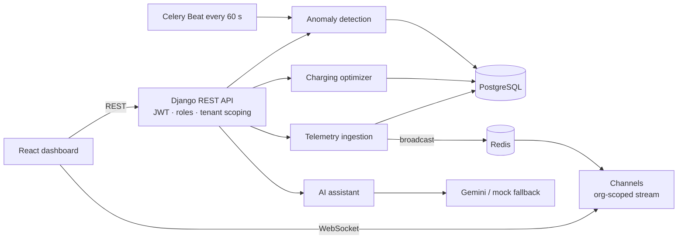
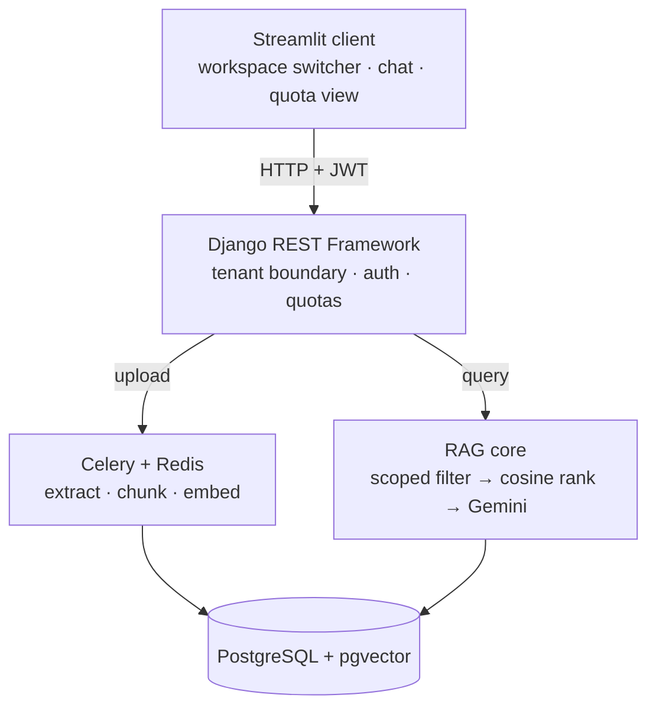

<!-- Save this file as README.md in a PUBLIC repository named exactly: ShashankSingh2020/ShashankSingh2020 -->

 

**🟢 Open to work: Python Developer · Backend Engineer · SDE (entry-level)**

---

## 📑 Quick navigation

[About](#-about-me) · [Quick facts](#-quick-facts) · [Education](#-education) · [Skills](#-skills) · [Projects](#-projects) · [Engineering themes](#-what-my-projects-have-in-common) · [How I learn](#-how-i-learn-and-practise) · [GitHub stats](#-github-stats) · [Contact](#-lets-connect)

---

## 👨‍💻 About me

I'm a **B.Tech Electronics & Communication Engineering** student at **Bangalore Institute of Technology**. I started in electronics, but what I enjoy most is software that does real work: APIs that stay correct under bad input, customer data that stays private, and background jobs that run on their own.

My focus is **backend development with Python**. I build with **Django, Django REST Framework, FastAPI and PostgreSQL**, and I care about the parts that make a backend trustworthy: authentication, role-based access, **multi-tenant data isolation**, audit trails, input validation and **automated tests**. I also add AI features (Google Gemini, retrieval-augmented generation) when they solve a real problem, and I build the frontends for my projects with **HTML, CSS, HTMX, Tailwind and React** at a basic level.

I'm looking for an **entry-level Python Developer, Backend Engineer or SDE role** where I can contribute to real systems and keep learning quickly.

---

## ⚡ Quick facts

| | |
|---|---|
| 🎓 **Studying** | B.Tech, Electronics & Communication Engineering, Bangalore Institute of Technology |
| 📈 **CGPA** | 8.78 |
| 🎯 **Targeting** | Python Developer · Backend Engineer · SDE (entry-level) |
| 🧠 **Core stack** | Python · Django · DRF · FastAPI · PostgreSQL · Redis |
| 🏗️ **Projects** | 6 backend projects: 4 multi-tenant systems, an AI code reviewer and an AI ATS tracker |
| ☁️ **Deployed** | RAG engine (Streamlit Cloud + Render), AI ATS tracker (Vercel) |
| 🧮 **DSA** | C++, roughly 80% of Striver's A2Z sheet completed |
| 🦈 **GitHub achievement** | Pull Shark |
| 🌐 **Currently studying** | Computer Networks |

---

## 🎓 Education

| Level | Institution | Result |
|---|---|---|
| **B.Tech, Electronics & Communication Engineering** | Bangalore Institute of Technology | **CGPA 8.78** |
| **Class XII** | St. Patrick's Senior Secondary School, Jaunpur, Uttar Pradesh | **86%** |
| **Class X** | St. Patrick's Senior Secondary School, Jaunpur, Uttar Pradesh | **86%** |

**Fundamentals I have completed:** Object-Oriented Programming, SQL, PostgreSQL, DBMS, Python, C++ and Data Structures & Algorithms.

---

## 🧰 Skills

  

| Area | What I work with |
|---|---|
| **Languages** | Python, C++, SQL |
| **Backend** | Django, Django REST Framework, FastAPI, Celery, JWT authentication, OpenAPI / Swagger |
| **Databases & caching** | PostgreSQL (including pgvector), SQLAlchemy 2.0 (async), Redis |
| **Frontend (basic)** | HTML, CSS, React, HTMX, Tailwind CSS, Streamlit |
| **Generative AI** | Google Gemini API, LangChain and Retrieval-Augmented Generation (RAG) |
| **DevOps & cloud basics** | Docker, Docker Compose, AWS fundamentals, Vercel, Render, Git, GitHub |
| **Testing & quality** | pytest, Ruff |
| **Core CS** | OOP, DBMS, Data Structures & Algorithms, Computer Networks (in progress) |

> 🔎 *Frontend skills are at a basic level: enough to build working dashboards and interfaces for my backend projects (React in VoltFleet, HTMX and Tailwind in the inventory ledger, HTML templates and CSS in Django apps).*

---

## 🚀 Projects

### 🗂️ At a glance

| Project | Domain | Key stack | What stands out |
|---|---|---|---|
| [**VoltFleet**](https://github.com/ShashankSingh2020/VoltFleet) | EV fleet operations | Django, DRF, PostgreSQL, Redis, Celery, Channels, React | Real-time telemetry, smart-charging optimizer, 27 automated tests |
| [**Multi-Tenant RAG Engine**](https://github.com/ShashankSingh2020/multi-tenant-rag-engine) | Enterprise AI search | Django, DRF, PostgreSQL + pgvector, Gemini, Celery, Streamlit | Tenant-scoped vector search, atomic quota metering, live demo |
| [**Support Ticket System**](https://github.com/ShashankSingh2020/support-ticket-system) | Customer support | Django, DRF, Celery, Redis, Gemini | State-machine workflow, SLA monitoring, AI classification |
| [**Multi-Tenant Inventory Ledger**](https://github.com/ShashankSingh2020/multi-tenant-inventory-ledger) | E-commerce / retail | Django, PostgreSQL, HTMX, Tailwind | Subdomain tenancy, auto-scoped queries, immutable ledger |
| [**AI Code Review**](https://github.com/ShashankSingh2020/AI-code-review) | Developer tools | FastAPI, SQLAlchemy 2.0 (async), Ruff, Radon, Gemini | Static analysis + AI review of any Git repository |
| [**AI ATS Tracker**](https://github.com/ShashankSingh2020/ai-ats-tracker) | Career tools | Django, Vercel | Deployed web app for ATS-style resume tracking |

---

### ⚡ VoltFleet: EV Fleet Intelligence & Smart Charging Platform

A **multi-tenant backend and dashboard for electric-vehicle fleets**. It ingests telemetry from vehicles, flags dangerous or suspicious conditions, schedules charging around electricity prices, streams live positions to a map and answers fleet questions through an AI assistant.

<b>🏢 Multi-tenancy and security</b>

 

- Custom email-based user model with **JWT authentication** (60-minute access tokens)
- **Four roles:** Platform Admin, Org Admin, Fleet Operator, Analyst, enforced with permission classes
- Every queryset is scoped to the caller's organization and backed by **tenant-isolation tests**
- Ingestion drops readings for vehicles outside the caller's organization
- WebSocket connections require a valid JWT and join **only their own organization's channel group**
- CORS allow-list, DRF throttling (including **15 requests/minute on AI chat**) and an `AuditLog` model

<b>📡 Telemetry ingestion</b>

 

- Single and batch endpoints; a batch is capped at **1,000 events**
- **Range validation**: state of charge 0–100 %, battery temperature −40 to 120 °C, latitude ±90, longitude ±180, no negative speed, odometer or energy
- **Duplicate-safe**: removed within a batch, checked against stored rows and backed by a unique `(vehicle, timestamp)` constraint
- Vehicle live state is reconciled with the newest reading inside a transaction

<b>🔋 Smart charging optimizer</b>

 

A deterministic **earliest-deadline-first, tariff-aware scheduler**: it sorts vehicles by departure deadline, sizes the energy needed, uses the lower of charger and vehicle power, rounds to **15-minute slots**, avoids conflicts per charger, prices windows against time-of-use tariffs (including overnight) and reports vehicles it **could not** schedule.

<b>🚨 Anomaly detection</b>

 

| Rule | Condition | Severity |
|---|---|---|
| High battery temperature | above 45 °C | Critical |
| Sudden SOC drop | more than 5 % within 10 minutes while moving under 2 km | High |
| Stale telemetry | no reading for over 120 minutes | Medium |

A 60-minute cool-down prevents duplicate alerts, and **Celery Beat** scans every organization every 60 seconds.

**Quality:** 27 automated tests (pytest), Ruff, OpenAPI/Swagger docs, Docker Compose for Postgres and Redis, a seed command and a telemetry simulator.
**Stack:** `Python` `Django` `DRF` `PostgreSQL` `Redis` `Celery` `Django Channels` `JWT` `Gemini API` `React` `Vite` `Tailwind CSS` `Docker`

---

### 🧠 Multi-Tenant Enterprise AI Knowledge Engine (RAG)

A **multi-tenant Retrieval-Augmented Generation SaaS platform**: private enterprise documents are ingested, embedded and searched semantically, with workspace isolation, background ingestion, quota metering and audit trails.

[🌐 **Live app**](https://multi-tenant-rag-engine.streamlit.app) · [📘 **API docs (Swagger)**](https://multi-tenant-rag-engine.onrender.com/api/docs/) · [💻 **Source**](https://github.com/ShashankSingh2020/multi-tenant-rag-engine)

> ⏳ *The API is hosted on a free tier, so the first request after a quiet period can take a little while to wake up.*

- 🛡️ **Strict tenant isolation:** data is partitioned `Organization → Project → Document → DocumentChunk`, and vector searches **pre-filter by project and organization membership before** similarity ranking, so one tenant's vectors never reach another tenant's query.
- ⚙️ **Asynchronous ingestion:** uploads return `201 Created` with a `PENDING` status immediately; **Celery workers** extract text, chunk it (300-word sliding window, 30-word overlap), generate Gemini embeddings and mark the document `READY`.
- 💳 **Concurrency-safe quotas:** token and query usage is metered per organization per billing cycle with PostgreSQL row locks (`select_for_update()`) and `F()` expressions, returning **HTTP 429** when a limit is reached.
- 🔎 **Vector search:** normalized **768-dimension embeddings** in **pgvector** with cosine distance, and **Gemini 2.5 Flash** answers that cite the source chunks.
- 📜 **Compliance:** role-based access control and an immutable audit trail for ingestion, authentication and AI queries.
- 🧰 **Stack:** `Django` `DRF` `PostgreSQL 16 + pgvector` `Gemini` `Celery` `Redis` `Streamlit` `drf-spectacular` `Docker` `pytest`

---

### 🎫 Enterprise Intelligent Support Ticket System

A production-style **backend for support ticket management**, built as a modular Django monolith with asynchronous AI classification, configurable SLA monitoring and role-based access control.

- 👥 **Custom email-based user model** with four roles (`ADMIN`, `MANAGER`, `AGENT`, `CUSTOMER`) enforced by server-side DRF permissions
- 🔁 **State-machine ticket workflow** with an immutable audit log (`TicketEvent`) written on every action
- ⏱️ **Configurable SLA monitoring** for tickets
- ⚙️ **Celery + Redis** background tasks dispatched with `transaction.on_commit` hooks, so a task never runs before its database transaction is saved
- 🤖 **Dual-mode AI classification:** a deterministic local mock mode that needs no API key, and a production **Google Gemini** integration
- 📘 Interactive **OpenAPI 3.0 / Swagger** documentation and **rate-limited endpoints**
- 🧰 **Stack:** `Django 5` `DRF` `Celery` `Redis` `Gemini` `drf-spectacular` `Docker` `pytest`

---

### 🏬 Enterprise Multi-Tenant E-Commerce Inventory Ledger

A retail platform that gives each vendor a **completely isolated store workspace** from a **single PostgreSQL database**, using a shared-database, row-level (discriminator column) tenancy strategy.

**The core challenge:** Vendor A must never read or leak into Vendor B's data, *even if a developer writes an un-scoped query like `Product.objects.all()`*.

1. **Subdomain routing middleware** reads the workspace from the host (for example `puma.localhost:8000`) and looks up the tenant.
2. **Thread-local scoping** stores the active tenant with `threading.local()`, keeping concurrent requests separate.
3. **Overridden QuerySet managers** add a `WHERE tenant_id = X` condition to every `SELECT` automatically.

- 🔒 An abstract `TenantBaseModel` assigns the tenant automatically on every insert
- 📒 `LedgerEntry` is an **append-only, double-entry transaction log**: past entries are immutable at the database layer
- 🛑 Model-level checks block cross-tenant links by verifying matching tenant IDs on foreign keys before saving
- 🖥️ **HTMX** gives fast page transitions with no hand-written JavaScript, styled with **Tailwind CSS**
- 🧰 **Stack:** `Django 5` `PostgreSQL (psycopg)` `HTMX` `Tailwind CSS`

---

### 🔍 AI Code Review + Repository Analyst

An automated **code review pipeline**: give it a Git repository and it produces an evidence-based health review.

- 📥 **Safe shallow cloning** with enforced branch, timeout and storage-size limits
- 🧪 **Deterministic static analysis** with **Ruff** for lint, runtime hazards and security checks
- 🌳 **AST and complexity analysis:** Python AST parsing finds dangerous constructs such as `eval` and bare `except`, and **Radon** scores cyclomatic complexity
- 🕸️ **Dependency graph mapping** of import relations across modules to show the project's structure
- 🤖 **AI synthesis:** executive code-health summaries written by **Google Gemini**, with an offline fallback so it works without a key
- 🧰 **Stack:** `FastAPI` `Uvicorn` `Pydantic v2` `SQLAlchemy 2.0 (async, asyncpg)` `Neon PostgreSQL` `Ruff` `Radon` `Gemini`

---

### 📄 AI ATS Tracker

A **Django web application** for ATS-style (applicant tracking system) resume tracking, **deployed on Vercel**.

[🌐 **Live app**](https://ai-ats-tracker-gray.vercel.app) · [💻 **Source**](https://github.com/ShashankSingh2020/ai-ats-tracker)

- 🧰 **Stack:** `Python` `Django` `HTML templates` `CSS` `Vercel`
- 🚢 Built and shipped end to end, from code to a public deployment

---

## 🧩 What my projects have in common

| Theme | Where it shows up |
|---|---|
| 🏢 **Multi-tenant data isolation** | VoltFleet, RAG engine, inventory ledger. I treat isolation as something to *test*, not just assume |
| ⚙️ **Asynchronous work** | Celery workers and Redis in VoltFleet, the RAG engine and the ticket system |
| 🤖 **Practical AI integration** | Gemini in five projects, always with a **mock or offline fallback** so the app still runs without an API key |
| 📜 **Audit trails** | Immutable logs in the RAG engine, ticket system and inventory ledger |
| 🔐 **Access control** | JWT authentication and role-based permissions |
| 📘 **API documentation** | OpenAPI / Swagger via drf-spectacular |
| 🐳 **Reproducible setup** | Docker and Docker Compose |
| ☁️ **Shipping** | Public deployments on Streamlit Cloud, Render and Vercel |

---

## 🌱 How I learn and practise

- 🧱 **Fundamentals first:** OOP, SQL, PostgreSQL, DBMS, Python, C++ and DSA are done before I build on top of them.
- 🛠️ **Self-taught frameworks:** I learned Django and Django REST Framework through online courses, then applied them in projects rather than stopping at tutorials.
- 🧮 **Consistent DSA practice in C++:** around 80% of Striver's A2Z sheet is complete. My current focus is turning an idea into working code quickly, including syntax and edge cases.
- 🧠 **Generative AI:** I completed a LangChain course that covers RAG, then built a multi-tenant RAG engine with pgvector and Gemini.
- ⚙️ **Infrastructure basics:** I completed courses on Docker, Redis and AWS.
- 🌐 **Next up:** Computer Networks, to understand what happens beneath every request.
- 🎓 **Community:** I forked GDSC BIT's Hacktoberfest 2023 repositories, and I hold GitHub's **Pull Shark** achievement.

---

## 📊 GitHub stats

---

## 🤝 Let's connect

I'm actively looking for **entry-level Python Developer, Backend Engineer and SDE** opportunities. If you're hiring, or you'd like to talk backend systems, multi-tenant design or AI integrations, reach out:

- 💼 **LinkedIn:** [shashank-pratap-singh](https://linkedin.com/in/shashank-pratap-singh-530437303)
- 📧 **Email:** [singh2020shashank@gmail.com](mailto:singh2020shashank@gmail.com)
- 🧩 **LeetCode:** [Shashank_pratap_singh](https://leetcode.com/u/Shashank_pratap_singh)

