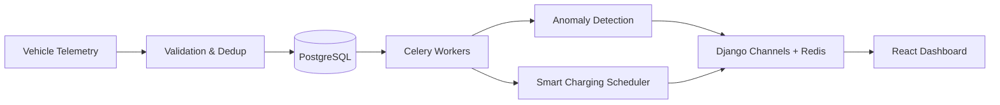
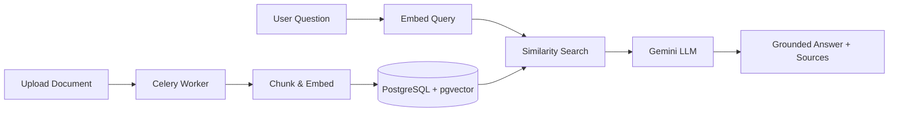

 

  

**🐍 Backend Developer &nbsp;·&nbsp; 🤖 AI Engineer &nbsp;·&nbsp; ⚡ Problem Solver &nbsp;·&nbsp; 🌱 Lifelong Learner**

*I turn ideas into reliable, well-tested software, and add AI where it genuinely helps.*

 

<a href="#-about-me">About</a> ·
<a href="#-at-a-glance">At a Glance</a> ·
<a href="#-tech-stack">Tech Stack</a> ·
<a href="#-featured-projects">Projects</a> ·
<a href="#-how-i-build">How I Build</a> ·
<a href="#-currently-levelling-up">Learning</a> ·
<a href="#-lets-connect">Contact</a>

---

## 👋 About Me

Hi, I'm **Shashank Pratap Singh** 👋

I'm a **B.Tech Electronics & Communication Engineering** student at **Bangalore Institute of Technology** (CGPA **8.78**). My degree is in electronics, but my real passion is **software**, specifically the part that happens *behind the screen*: APIs, databases, background jobs, authentication, and the logic that keeps real systems correct.

I enjoy building applications that go **beyond basic CRUD**. That means systems with:

- 🔐 Authentication and role-based access control
- 🏢 Strict separation of data between organizations and workspaces
- ⚙️ Asynchronous processing with background workers
- 📜 Audit trails and event histories for important actions
- 🗄️ Careful database design with constraints and transactions
- 🧪 Automated tests that cover business rules and edge cases

I also like **applied AI**. I don't add an LLM just to say a project has AI. I use it where it solves a real problem: answering questions from private documents (RAG), triaging support tickets, and summarising code-quality reports. Where possible, I pair the AI features with deterministic logic and offline fallbacks so the system still works without them.

On the frontend, I have **basic working knowledge** of React, HTML, CSS, Tailwind, HTMX and Streamlit. I use them to build dashboards and interfaces that make my backends usable.

> 💬 *My goal isn't just to make an application run. It's to make it secure, maintainable, and reliable.*

### 🔭 What I'm focused on right now

- 🏗️ Building backend-focused projects with real engineering concepts
- 🤖 Working with LLM APIs and Retrieval-Augmented Generation
- ⚙️ Exploring background jobs, caching, API design and database architecture
- 🧠 Practising **Data Structures & Algorithms in C++** for technical interviews
- 🎯 Preparing for entry-level **Python Developer, Backend Engineer and SDE** roles

---

## ⚡ At a Glance

<table>
<tr>
<td width="50%" valign="top">

### 🎓 Education
**B.Tech, Electronics & Communication Engineering**
Bangalore Institute of Technology

📊 **CGPA: 8.78**

</td>
<td width="50%" valign="top">

### 🎯 Target Roles
- Python Developer
- Backend Engineer
- Software Development Engineer (SDE), entry-level

</td>
</tr>
<tr>
<td width="50%" valign="top">

### 💻 Primary Focus
- Python backend development
- Django, DRF and FastAPI
- PostgreSQL and Redis
- REST APIs and authentication
- Practical AI integrations (RAG, LLMs)

</td>
<td width="50%" valign="top">

### 🛠️ How I Work
- Backend-first design
- Data isolation between organizations
- Async task processing
- Automated testing
- Docker-based development

</td>
</tr>
</table>

---

## 🧰 Tech Stack

**Languages**

**Backend & APIs**

**Databases & Caching**

**AI / GenAI**

**DevOps & Tools**

**Frontend (working knowledge)**

 

| Category | Technologies | What I use them for |
|---|---|---|
| **Languages** | Python, C++, SQL | Python for backend and AI work, C++ for DSA and interview practice, SQL for data modelling and queries |
| **Backend** | Django, Django REST Framework, FastAPI | REST APIs, authentication, role-based permissions, business logic |
| **Async & scheduling** | Celery, Redis, scheduled tasks | Document ingestion, SLA monitoring, telemetry processing, background jobs |
| **Databases** | PostgreSQL, pgvector, SQLAlchemy | Relational models, constraints, transactions, vector similarity search |
| **Real-time** | Django Channels, Redis | Live updates on dashboards |
| **AI / GenAI** | Gemini API, LangChain, RAG, vector search | Grounded Q&A, ticket classification, AI-written code summaries |
| **Frontend** | React, HTML, CSS, Tailwind CSS, HTMX, Streamlit | Dashboards and interfaces for my backends |
| **Infrastructure** | Docker, Docker Compose, AWS fundamentals | Reproducible local environments and deployment basics |
| **Quality & API docs** | pytest, Ruff, OpenAPI / Swagger | Testing, linting, interactive API documentation |
| **Version control** | Git, GitHub | Day-to-day workflow |

*Frontend skills are at a working-knowledge level. My strongest focus is backend development.*

---

## 🚀 Featured Projects

I like projects that show real backend engineering, not just simple demo apps. Here are six of them, from real-time fleet systems to AI-powered document search.

 

### ⚡ 1. VoltFleet: EV Fleet Intelligence & Smart Charging

[**View Repository →**](https://github.com/ShashankSingh2020/VoltFleet)

**The problem:** An electric-vehicle fleet produces a constant stream of telemetry (battery level, temperature, charging state). Operators need to know which vehicles need attention, and when and where to charge them cheaply without missing departure deadlines.

**What I built:** A fleet-management platform that ingests vehicle telemetry, schedules charging, detects anomalies, and pushes live updates to a dashboard.

**Key features**

- 📡 **Telemetry ingestion:** validated incoming readings with duplicate handling, so repeated or malformed data doesn't corrupt the records
- 🏢 **Organization boundaries:** each organization sees only its own fleet, with role-based access control
- 🔋 **Smart charging:** charging schedules built from each vehicle's deadline and electricity tariffs
- 🚨 **Anomaly detection:** flags abnormal battery temperature, sudden charge drops, and stale telemetry from vehicles that stopped reporting
- 🔴 **Real-time updates:** live communication using Django Channels and Redis
- 📊 **Dashboard:** a React frontend connected to the backend API

**What it demonstrates:** data validation, scheduling logic, background processing, real-time communication, and clean separation between organizations.

**Tech:** `Python` `Django` `DRF` `PostgreSQL` `Redis` `Celery` `Django Channels` `React` `Docker`

---

### 🧠 2. Enterprise AI Knowledge Engine (RAG Platform)

[**Repository →**](https://github.com/ShashankSingh2020/multi-tenant-rag-engine) · [**Live Application**](https://multi-tenant-rag-engine.streamlit.app) · [**API Documentation**](https://multi-tenant-rag-engine.onrender.com/api/docs/)

**The problem:** Teams have private documents and want accurate answers from them, without sending data to the wrong people and without an LLM making things up.

**What I built:** A document knowledge platform. Users upload documents to their workspace, the system indexes them, and questions are answered by an LLM using only the retrieved, relevant passages, with sources.

**Key features**

- 🏢 **Isolation:** documents are separated at the organization and project level
- 📥 **Async ingestion:** document processing and embedding generation run in background workers, so uploads don't block the API
- 🔎 **Semantic retrieval:** vector similarity search using PostgreSQL with pgvector
- 💬 **Grounded answers:** Google Gemini generates answers from retrieved context, with sources
- 📏 **Quota tracking:** usage limits per organization
- 📜 **Audit logging:** a record of important operations
- 🖥️ **Live demo:** a Streamlit interface plus Swagger/OpenAPI documentation

**What it demonstrates:** an end-to-end RAG pipeline, async workers, vector search in a relational database, and access control around sensitive documents.

**Tech:** `Python` `Django` `DRF` `PostgreSQL` `pgvector` `Celery` `Redis` `LangChain / RAG` `Gemini` `Streamlit`

---

### 🎫 3. Intelligent Support Ticket System

[**View Repository →**](https://github.com/ShashankSingh2020/support-ticket-system)

**The problem:** Support teams need clear ownership, predictable workflows, and a way to notice tickets that are about to breach their service targets.

**What I built:** A backend-focused support platform with role-based workflows, controlled status changes, SLA monitoring, and AI-assisted classification.

**Key features**

- 👥 **Four roles:** customer, agent, manager and admin, each with its own permissions
- 🔄 **Controlled state transitions:** tickets can only move through allowed states, and every change is logged as an event
- ⏱️ **SLA monitoring:** configurable service-level rules checked by background tasks
- ⚙️ **Background processing:** Celery and Redis handle scheduled and long-running work
- 🤖 **AI classification:** Gemini helps categorise tickets, with a **local mock mode** so the system works without an API key
- 📘 **API docs and tests:** documented endpoints and automated tests

**What it demonstrates:** workflow design, permission modelling, event logging, scheduled jobs, and designing AI features that degrade gracefully.

**Tech:** `Python` `Django` `DRF` `PostgreSQL` `Celery` `Redis` `Gemini` `Docker`

---

### 🔍 4. AI Code Review & Repository Analyst

[**View Repository →**](https://github.com/ShashankSingh2020/AI-code-review)

**The problem:** Opening an unfamiliar repository, it's hard to tell quickly where the complexity, risks and dependencies are.

**What I built:** A developer tool that analyses a Git repository and produces a structured overview of code quality, complexity, dependencies and likely issues.

**Key features**

- 🧹 **Static analysis** with Ruff
- 🌳 **Python AST analysis** and **cyclomatic complexity** metrics
- 🕸️ **Dependency mapping** between modules
- ✨ **AI-generated summaries** using Google Gemini
- 📴 **Offline fallback:** core analysis still works when no API key is available

**What it demonstrates:** code analysis, working with Python's AST, FastAPI service design, and keeping deterministic analysis separate from AI-written commentary.

**Tech:** `Python` `FastAPI` `SQLAlchemy` `PostgreSQL` `Ruff` `Radon` `Gemini`

---

### 🏬 5. Multi-Tenant Inventory Ledger

[**View Repository →**](https://github.com/ShashankSingh2020/multi-tenant-inventory-ledger)

**The problem:** Several vendors share one platform, but each must see only its own stock, and every stock change must be traceable.

**What I built:** An inventory backend with isolated vendor workspaces and reliable transaction records.

**Key features**

- 🌐 **Subdomain-based tenant identification:** each vendor is recognised from its subdomain
- 🔒 **Tenant-scoped queries and models:** data access is limited to the current vendor
- 📒 **Append-only ledger:** transaction history is recorded, not overwritten
- 🖥️ **Server-rendered UI:** HTMX and Tailwind CSS for a fast, simple interface

**What it demonstrates:** tenant isolation, ledger-style data modelling, and server-driven UI.

**Tech:** `Python` `Django` `PostgreSQL` `HTMX` `Tailwind CSS`

---

### 📄 6. AI ATS Tracker

[**View Repository →**](https://github.com/ShashankSingh2020/ai-ats-tracker) · [**Live Application**](https://ai-ats-tracker-gray.vercel.app)

A Django web application for applicant-tracking and resume-related workflows, with a template-based interface and a public deployment.

**Tech:** `Python` `Django` `HTML` `CSS` `Vercel`

---

## 🧩 How I Build

| | Principle | How I apply it |
|:---:|---|---|
| 🔐 | **Authentication & authorization** | JWT authentication, roles, and permission checks on every sensitive endpoint |
| 🏢 | **Data isolation** | Organization-scoped data access, with tests that check data doesn't leak between organizations |
| 🗄️ | **Database design** | Relational models, constraints, transactions, and PostgreSQL features |
| ⚙️ | **Async processing** | Celery workers, Redis, and scheduled background tasks |
| 📜 | **Auditability** | Event histories and audit logs for important operations |
| 🚦 | **API reliability** | Input validation, throttling, clear API contracts, and consistent error handling |
| 🧪 | **Testing** | Automated tests for business logic and important edge cases |
| 🤖 | **Practical AI** | Combining deterministic logic with LLM features, plus fallbacks when the AI is unavailable |
| 🐳 | **Reproducible setup** | Docker and Docker Compose so projects run the same everywhere |

I try to understand not just *how* to implement a feature, but also the **trade-offs, failure cases and security considerations** behind it.

---

## 📈 GitHub Stats

 

---

## 🌱 Currently Levelling Up

| Area | What I'm working on |
|---|---|
| 🧮 **DSA** | Solving interview-style problems in C++ and revising core patterns |
| 🏗️ **Backend engineering** | Better API design, database handling, security and testing |
| 🌐 **Core CS** | OOP, DBMS, operating systems and computer networks |
| 🤖 **AI engineering** | Practical RAG pipelines, vector search and LLM integrations |
| ☁️ **Infrastructure** | Docker, Redis, background workers, cloud and deployment basics |
| 🎨 **Frontend basics** | React, HTML and CSS, enough to build complete applications |

> I believe consistent practice, debugging, and understanding the reasoning behind a solution matter more than collecting technologies.

---

## 🎯 What I'm Looking For

I'm looking for **entry-level Python Developer, Backend Engineer and SDE roles** where I can:

- ✅ Build and maintain backend services and APIs
- ✅ Work with databases, background jobs and real production-style problems
- ✅ Learn from experienced engineers and ship useful software
- ✅ Contribute to products that use AI in practical ways

---

## 🤝 Let's Connect

Whether it's backend engineering, API development, database architecture or practical AI, I'm always happy to connect and learn.

  
  
  

### 💡 Build. Learn. Debug. Improve. Repeat.

*Thanks for visiting my profile!*

